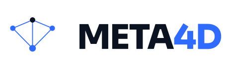

<picture>
  <source media="(prefers-color-scheme: dark)" srcset="logo-dark.svg">
  
</picture>

### Aerial data, turned into decisions.

Meta4D processes drone imagery into orthomosaics, 3D models and change reports, 
for solar farms, wind turbines, powerlines, structures and crops.

[Website](https://meta4d.ai) · [Contact](mailto:hello@meta4d.ai)

---

## What we build

| | |
|---|---|
| 🛰️ **Processing** | Drone imagery turned into orthomosaics and 3D models |
| 🔍 **Inspection** | Findings for solar farms, wind turbines, powerlines and structures |
| 🌱 **Agriculture** | Crop intelligence from aerial data |
| 📈 **Change reports** | Every asset, every flight, compared against the last one |

## Status

The platform is in development. To hear when it opens, or to talk about a pilot, email **[hello@meta4d.ai](mailto:hello@meta4d.ai)**.

---

Meta4D is built by Metavystic.

